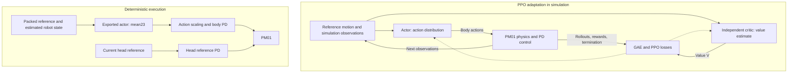
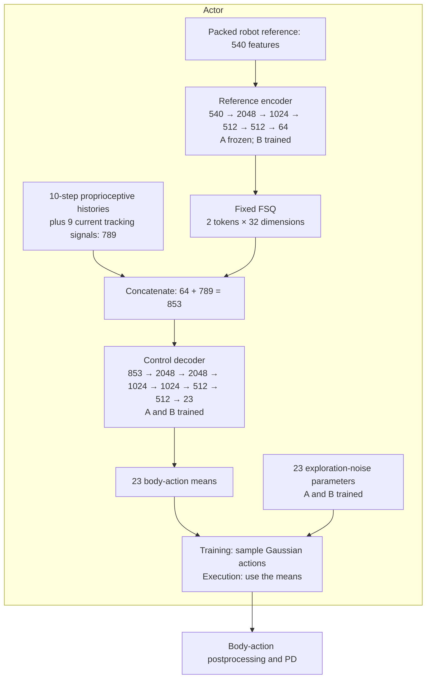
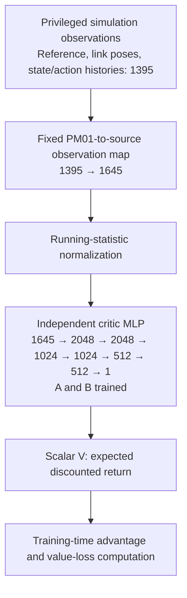

# Architecture

SONIC-PM01 is an independent research adaptation of the released NVIDIA GEAR-SONIC controller to EngineAI PM01. The A/B experiments use SONIC's **robot-reference tracking branch**: a reference encoder, a fixed finite scalar quantizer (FSQ), and a control decoder. They use dense fine-tuning, with no LoRA layers in the released actors.

PM01 has 24 controlled joints in this setup. The actor emits 23 body-action means; the head uses a separate reference-PD path. These models track supplied motion references. An online locomotion planner and a hardware state estimator are separate integration tasks.

## Overview: training and execution



[Static SVG view](diagrams/overview.svg)

Solid arrows carry data. Dotted arrows update parameters. PPO does not differentiate through the physics engine. The critic supplies training-time value estimates; it is absent from the deterministic actor export.

## Actor



[Static SVG view](diagrams/actor.svg)

Hidden layers use SiLU. The deterministic inference artifact contains approximately 13.9 million encoder/decoder parameters. It excludes the critic, optimizer state, exploration-noise parameters, inactive SONIC input branches, and the kinematic planner. The FSQ arithmetic and the folded PM01 boundary weights are preserved in the export; the export is not a new training run.

| Adaptation variant | Reference encoder | Control decoder | Exploration noise | Critic MLP |
|---|---|---|---|---|
| A (`decoder_only`) | Frozen | Trained | Trained | Trained |
| B (`full_actor`) | Trained | Trained | Trained | Trained |

The decoder is part of the actor. Training A's decoder is therefore actor training. `freeze_encoder_internal` is a control for a different, unused training profile; it does not override B's `full_actor` selection.

### Exported interface and packing

The fixed-batch ONNX interface is:

| Tensor | Shape | Type | Meaning |
|---|---|---|---|
| `actor_obs` | `[1, 789]` | float32 | Already packed native observations |
| `tokenizer` | `[1, 541]` | float32 | Route selector and reference storage |
| `mean23` | `[1, 23]` | float32 | Native body-action means, before action scaling |

`tokenizer` storage is **selector1 | q240 | qd240 | orientation60**. The encoder input is constructed as:

```python
command = tokenizer[:, 1:481].reshape(-1, 10, 48)
orientation = tokenizer[:, 481:541].reshape(-1, 10, 6)
encoder_input = concatenate([command, orientation], axis=-1).reshape(-1, 540)
```

The `(10, 48)` storage view does **not** mean that the preceding buffer contains ten interleaved `[q24, qd24]` frames. Rearranging it into that interpretation changes the policy input. The fixed exported graph ignores the selector's value, while the public interface requires the canonical single robot-reference route selector **1**.

`actor_obs` storage is **omega30 | relative_q240 | relative_qd240 | raw_action_history240 | gravity30 | current_feedback9**. Histories are grouped by observation term, not interleaved into ten 78-feature frames. The reference samples and state histories are different: reference sampling uses the saved 0.1-second interval, while state/action history follows the 50 Hz controller. Orientation features and history order must follow the saved observation contract; arbitrary quaternion or 6D-rotation conventions are not interchangeable.

The nine current-frame feedback features are:

1. Reference-minus-actual anchor position, rotated into the actual `LINK_BASE` frame and multiplied by 5 (three features).
2. Actual root **link-origin** linear velocity in that frame (three features).
3. Reference anchor linear velocity in that frame (three features).

These signals are not repeated across the ten history steps. A real system must supply the same frame conventions through a calibrated state estimate. Center-of-mass velocity is not a substitute for link-origin velocity.

### Actions and head

`mean23` is not a torque or an absolute joint-angle vector. The shared `control_contract.json` records the native joint order and symbolic action mapping. It deliberately does not publish unverified cross-checkpoint defaults, action scales, clip bounds, or hardware joint order. Those numerical parameters must come from the corresponding validated controller configuration. The simulation mapping has the form `default_q + action_scale * clipped_raw_action`; the head's raw action is composed separately from its current reference angle. The recorded simulation runs use a 50 Hz policy and 200 Hz physics/PD stepping.

The CPU inference example only evaluates the neural network. It does not implement robot transport, state estimation, physical-limit supervision, or a validated hardware controller.

## Critic



[Static SVG view](diagrams/critic.svg)

The critic is initialized from the source value network, with target-adaptation normalization statistics established separately. Its MLP weights are fully trainable in A and B, while the observation map is fixed. It does not reuse the actor encoder, FSQ, or decoder. Its history includes linear velocity; the actor history includes gravity direction. These are different input tensors, despite some overlapping state variables.

## Attribution and scope

Built on [NVIDIA GEAR-SONIC](https://nvlabs.github.io/GEAR-SONIC/). The adaptation study takes inspiration from [Any2Any](https://any2any.top/); the A/B models implement different dense update scopes. Earlier experiments in the working project used LoRA, but those experiments must not be substituted for the A/B results described here. The public deterministic inference implementation is packaged independently of the historical training checkout. See the module provenance and licensing notes for implementation sources.

Architecture and export fidelity describe the network computation. Physical tracking results, data populations, and limitations are documented separately in [evaluation.md](evaluation.md) and [limitations.md](limitations.md).
